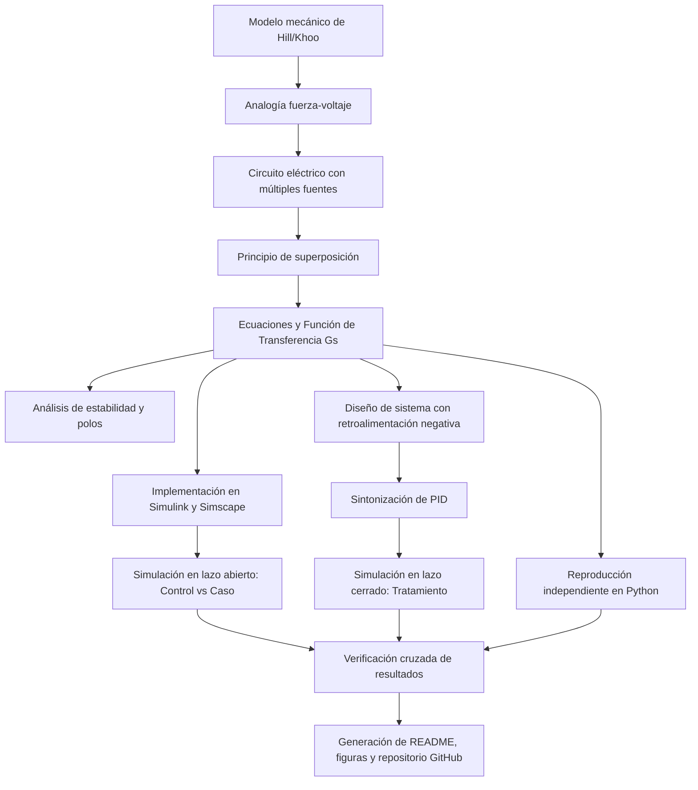

# Práctica 3 (5.5) — Modelo y control del sistema musculoesquelético

Repositorio académico de la asignatura **Modelado de Sistemas Fisiológicos**, correspondiente al programa de **Ingeniería Biomédica** del Tecnológico Nacional de México / Instituto Tecnológico de Tijuana. Esta práctica integra el modelado mecánico del sistema musculoesquelético de Hill/Khoo, analogías electromecánicas (fuerza-voltaje), formulación matemática mediante el principio de superposición, análisis de estabilidad, simulación computacional y diseño de estrategias de control *in silico* para mitigar los efectos de la atrofia muscular.

El caso de estudio modela un compartimento musculoesquelético con un elemento contráctil activo, amortiguamiento viscoso y compliancias elásticas en serie y paralelo. Se busca reproducir y comparar la respuesta del desplazamiento o fuerza transmitida entre un individuo sano (*control*) y un caso simulado de atrofia muscular (*caso*), implementando un controlador PID con retroalimentación negativa (*tratamiento*) para reducir la diferencia entre ambas respuestas.

**Docente:** Dr. Paul Antonio Valle Trujillo  
**Correo:** paul.valle@tectijuana.edu.mx  
**Departamento:** Ingeniería Eléctrica y Electrónica  
**Institución:** Tecnológico Nacional de México / Instituto Tecnológico de Tijuana  
**Asignatura:** Modelado de Sistemas Fisiológicos  
**Programa:** Ingeniería Biomédica  
**Estudiante:** Zaid Alexander Arredondo Medina · 23212180 · L23212180@tectijuana.edu.mx  

**Repositorio de la asignatura:** https://github.com/DrPaulValle/MSF-IBF1020  
**Sede:** Blvd. Alberto Limón Padilla s/n, Tijuana, C. P. 22454, B. C., México.

---

<a id="contenido"></a>
## Contenido

1. [Resumen](#resumen)
2. [Competencia y objetivos](#objetivos)
3. [Relación con el temario](#temario)
4. [Modelo mecánico y analogía eléctrica](#analogia)
5. [Diagrama biológico del sistema](#diagrama-biologico)
6. [Formulación matemática por superposición](#modelo)
7. [Análisis temporal y de estabilidad](#analisis)
8. [Señales de entrada y condiciones de simulación](#senales)
9. [Implementación en MATLAB, Simulink y Simscape](#matlab)
10. [Control en lazo cerrado y sintonización PID](#pid)
11. [Reproducción en Python](#python)
12. [Resultados y verificación cruzada](#resultados)
13. [Flujo de trabajo](#flujo)
14. [Actividades del estudiante](#actividades)
15. [Estructura del repositorio](#estructura)
16. [Requisitos](#requisitos)
17. [Reproducibilidad y entregables](#reproducibilidad)
18. [Referencias](#referencias)

---

<a id="resumen"></a>
## Resumen

La práctica tiene como propósito **reproducir un procedimiento completo de modelado, análisis, simulación y control** de un sistema biomecánico utilizando analogías de sistemas físicos. El sistema musculoesquelético se representa mediante elementos de Hill (elemento contráctil activo, amortiguador viscoso $R$, compliancia en paralelo $C_p$ y compliancia en serie $C_s$). Mediante la analogía fuerza-voltaje se transforma el sistema mecánico en un circuito eléctrico equivalente con múltiples fuentes, requiriendo la aplicación inexcusable del principio de superposición para obtener su función de transferencia.

Se estudia el error en estado estacionario y la estabilidad del modelo a través de los polos de la planta. Posteriormente se aplica una entrada de pulso y se contrastan las implementaciones en MATLAB/Simulink/Simscape Electrical. Se incorpora un **controlador PID con retroalimentación negativa**, cuyas ganancias se sintonizan para reducir el error entre la respuesta del individuo sano (*control*) y el paciente con atrofia muscular (*caso*). Los resultados se reproducen mediante Python y se documentan formalmente en un repositorio de GitHub.

**Palabras clave:** sistema musculoesquelético; modelo de Hill; analogía fuerza-voltaje; principio de superposición; controlador PID; atrofia muscular; MATLAB; Simulink; Simscape Electrical; Python.

[Volver al contenido](#contenido)

---

<a id="objetivos"></a>
## Competencia y objetivos

### Competencia a desarrollar

Modeliza sistemas fisiológicos mediante analogías entre sistemas físicos, ecuaciones diferenciales y funciones de transferencia para analizar su comportamiento dinámico y diseña estrategias de control mediante técnicas de control clásico. En particular, analiza un modelo mecánico simplificado del sistema musculoesquelético, construye su circuito eléctrico equivalente, compara un individuo sano con un caso de atrofia muscular y diseña una estrategia de control *in silico*.

### Objetivo general

Reproducir y verificar el modelo del sistema musculoesquelético mediante su formulación matemática con superposición, implementación computacional, control con retroalimentación y comparación de respuestas ante la condición de salud y patología simulada.

### Objetivos específicos

- Identificar los elementos mecánicos del modelo (contráctil, amortiguador, compliancias) y sus restricciones de fuerza y desplazamiento.
- Aplicar la analogía fuerza-voltaje para convertir el sistema mecánico en un circuito eléctrico equivalente.
- Formular las ecuaciones del sistema aplicando rigurosamente el principio de superposición debido a la presencia de múltiples fuentes.
- Obtener la función de transferencia del sistema $G(s)$ mediante la transformada de Laplace.
- Determinar analíticamente el error en estado estacionario y analizar la estabilidad mediante el polo de la planta.
- Simular el modelo mediante bloques matemáticos en Simulink, funciones de transferencia y componentes de Simscape Electrical.
- Comparar las respuestas temporales del individuo sano (*control*) frente al caso de atrofia muscular (*caso*).
- Implementar un sistema de control con retroalimentación y sintonizar un controlador PID para el tratamiento de la atrofia.
- Reproducir las respuestas de lazo abierto y lazo cerrado mediante MATLAB y Python.
- Documentar los resultados numéricos y estructurar el repositorio en GitHub.

[Volver al contenido](#contenido)

---

<a id="temario"></a>
## Relación con el temario

La práctica integra contenidos correspondientes a tres unidades de la asignatura **Modelado de Sistemas Fisiológicos (IBF-1020)**:

| Unidad | Área | Contenidos aplicados |
|---|---|---|
| I | Sistemas de control retroalimentados | Elementos del sistema de control, diagramas de bloques, señal de error y comparación de respuestas |
| II | Modelado matemático | Analogía fuerza–voltaje, principio de superposición, función de transferencia de sistemas biomecánicos |
| III | Controladores | Tipos de controladores, diseño del PID y sintonización para corrección de patologías simuladas |

El enfoque combina **Ingeniería de Control, Biomecánica y Ciencias de la Computación**, de acuerdo con la competencia de la asignatura.

[Volver al contenido](#contenido)

---

<a id="analogia"></a>
## Modelo mecánico y analogía eléctrica

El sistema musculoesquelético se aproxima mediante un modelo viscoelástico basado en los elementos de Hill, el cual incluye un elemento activo F0(t), un amortiguador viscoso R, y compliancias elásticas en serie Cs y paralelo Cp.

| Símbolo | Equivalente eléctrico | Interpretación biomecánica / fisiológica |
|---|---|---|
| $F(t)$ | Voltaje de entrada $V(t)$ | Fuerza aplicada o transmisiones externas |
| $F_0(t)$ | Fuente dependiente $\alpha F(t)$ | Fuerza desarrollada por el elemento contráctil activo ($0 < \alpha < 1$) |
| $\dot{x}(t)$ | Corriente eléctrica $I(t)$ | Velocidad de deformación o desplazamiento |
| $x(t)$ | Carga eléctrica $q(t)$ | Desplazamiento mecánico |
| $R$ | Resistencia $R$ | Amortiguamiento viscoso del tejido |
| $C_p, C_s$ | Capacitancias $C_p, C_s$ | Compliancias mecánicas (sarcolema, tendones) |

### Parámetros para la experimentación *in silico*

| Parámetro | Control (Sano) | Caso (Atrofia muscular) | Unidad eléctrica |
|---|---:|---:|---|
| $F(t)$ | $1$ | $1$ | $\mathrm{V}$ |
| $\alpha$ | $0.25$ | $0.25$ | Adimensional |
| $C_s$ | $10\times 10^{-6}$ | $10\times 10^{-6}$ | $\mathrm{F}$ ($\mu\mathrm{F}$) |
| $C_p$ | $100\times 10^{-6}$ | $100\times 10^{-6}$ | $\mathrm{F}$ ($\mu\mathrm{F}$) |
| $R$ | $100$ | $10\,000$ ($10\,\mathrm{k}\Omega$) | $\Omega$ |

La atrofia muscular se modela incrementando el valor del amortiguamiento $R$ de $100\,\Omega$ a $10\,\mathrm{k}\Omega$, lo que altera de forma drástica la constante de tiempo y la dinámica temporal del tejido.

[Volver al contenido](#contenido)

---

<a id="diagrama-biologico"></a>
## Diagrama biológico del sistema

Para comprender la correspondencia anatómica y fisiológica del modelo mecánico de Hill/Khoo, se elaboró un **diagrama biológico mediante BioRender**. Este diagrama vincula cada componente del circuito equivalente y del modelo mecánico con las estructuras histológicas y anatómicas del sistema musculoesquelético:


### Correspondencia anatómica y fisiológica de los componentes:

1. **Elemento contráctil activo (F0(t)) — Sarcómeros:**
   Representa la fuerza activa generada por el filamento deslizante de actina y miosina dentro de las miofibrillas (sarcómero). Es el componente generador de fuerza dependiente de la activación celular.

2. **Compliancia en serie (Cs) — Tendones y aponeurosis:**
   Modela las propiedades elásticas de los elementos conectivos dispuestos en serie con las fibras musculares (principalmente el tendón principal, epimisio, perimisio y aponeurosis). Almacena energía elástica durante la contracción.

3. **Compliancia en paralelo (Cp) — Sarcolema, fascias y tejido adiposo:**
   Representa la elasticidad pasiva de las estructuras que envuelven linealmente al músculo, tales como el sarcolema, el endomisio, las fascias musculares externas y el tejido adiposo circundante.

4. **Amortiguamiento viscoso (R) — Tejido blando viscoso y citoplasma:**
   Símbolo de la resistencia viscosa interna ejercida por el sarcoplasma, el fluido intersticial y la fricción entre las capas de tejido blando durante la deformación y el movimiento muscular.

5. **Fuerza total transmitida (F(t)) — Unión músculo-hueso (Unión miotendinosa):**
   Corresponde a la fuerza resultante transmitida hacia el sistema óseo a través de la inserción miotendinosa para producir la tracción y el movimiento articular.
   


[Volver al contenido](#contenido)

---

<a id="modelo"></a>
## Formulación matemática por superposición

### 1. Aplicación del principio de superposición

Dado que el circuito equivalente contiene múltiples fuentes (F(t) y la fuente dependiente F0(t) = αF(t)), se descompone el análisis en dos circuitos auxiliares:

* **Circuito 1 (Apagando F0(t)):** Analizando la contribución de la fuerza principal sobre el nodo del sistema, se obtiene la respuesta parcial en Laplace:
  
  F{s1}(s) = {Cs R s + 1}/{R(Cp + Cs)s + 1} F(s)
  

* **Circuito 2 (Apagando F(t)):** Considerando la acción exclusiva de la fuente activa -F0(s) = -αF(s) sobre las compliancias equivalentes en paralelo (Cp + Cs), la respuesta parcial es:
  
  F{s2}(s) = {-α}{R(Cp + Cs)s + 1} F(s)
  

### 2. Función de transferencia total

Sumando ambas contribuciones (Fs(s) = F{s1}(s) + F{s2}(s)), se consolida la función de transferencia del sistema musculoesquelético:

{G(s) = {Fs(s)}/{F(s)} = {Cs R s + (1 - α)}{R(Cp + Cs)s + 1}}


El modelo resultante corresponde a un sistema de **primer orden**, caracterizado por una única constante de tiempo τ = R(Cp + Cs).

[Volver al contenido](#contenido)

---

<a id="analisis"></a>
## Análisis temporal y de estabilidad

### 1. Error en estado estacionario

Para una entrada de tipo escalón unitario $F(s) = \frac{1}{s}$, el error en estado estacionario se calcula mediante el teorema del valor final:

$$
e_{ss} = \lim_{s\to 0} s F(s) [1 - G(s)] = 1 - G(0) = 1 - (1 - \alpha) = \boxed{\alpha}
$$

El error permanente ante una entrada escalón depende estrictamente del factor de contracción muscular $\alpha$.

### 2. Polo y estabilidad

El polo del sistema se determina igualando a cero el polinomio del denominador:

$$
R(C_p + C_s)s + 1 = 0 \implies \boxed{s_1 = -\frac{1}{R(C_p + C_s)}}
$$

Puesto que $R > 0$, $C_p > 0$ y $C_s > 0$, la parte real del polo es negativa ($\text{Re}(s_1) < 0$), lo que comprueba matemáticamente que **el sistema en lazo abierto es estable**. Sin embargo, el aumento de $R$ en la condición de atrofia incrementa el tiempo de establecimiento de la respuesta transitoria.

[Volver al contenido](#contenido)

---

<a id="senales"></a>
## Señales de entrada y condiciones de simulación

El intervalo nominal de simulación es $0 \le t \le 10\,\mathrm{s}$. Se configura un método numérico rígido (`ode15s`) con un paso máximo de integración $\Delta t = 10^{-3}\,\mathrm{s}$.

* **Entrada de excitación $F(t)$:** Señal de pulso con amplitud de $1\,\mathrm{V}$, activa en el intervalo de $t = 1\,\mathrm{s}$ a $t = 2\,\mathrm{s}$.
* **Escenarios evaluados:**
  1. *Control:* Individuo sano con amortiguamiento nominal ($R = 100\,\Omega$).
  2. *Caso:* Condición de atrofia muscular en lazo abierto ($R = 10\,\mathrm{k}\Omega$).
  3. *Tratamiento:* Sistema controlado mediante lazos de retroalimentación y compensación PID.

[Volver al contenido](#contenido)

---

<a id="matlab"></a>
## Implementación en MATLAB, Simulink y Simscape

El desarrollo computacional se compone de tres vertientes principales:
1. **Modelo matemático en Simulink (`Sistema3.slx`):** Implementación estructurada mediante bloques de ganancia, suma e integración.
2. **Función de transferencia:** Validación analítica mediante la representación polinómica $G(s)$.
3. **Simscape Electrical:** Construcción del circuito eléctrico equivalente con componentes pasivos discretos.

El script recupera las variables del *Workspace* y utiliza la función automatizada `plotSignals` para estructurar y exportar la gráfica vectorial resultante.

[Volver al contenido](#contenido)

---

<a id="pid"></a>
## Control en lazo cerrado y sintonización PID

Para restablecer el comportamiento dinámico del paciente afectado por atrofia muscular, se implementa una estrategia de control con retroalimentación negativa:

$$
e(t) = x_{\mathrm{control}}(t) - x_{\mathrm{caso}}(t)
$$

Se integra el bloque **PID Controller** optimizado a través de la herramienta interactiva *Tune* de Simulink, obteniendo los parámetros $k_P$, $k_I$ y $k_D$ idóneos para que la respuesta de *tratamiento* converja con precisión hacia la referencia del individuo *sano*.

[Volver al contenido](#contenido)

---

<a id="python"></a>
## Reproducción en Python

Como parte de la metodología de verificación cruzada, se elabora un programa independiente en Python desde **Visual Studio Code**:
- Se cargan los objetos de función de transferencia correspondientes al control y al caso.
- Se simula la respuesta temporal ante el mismo pulso de excitación.
- Se incorporan las acciones de control del PID para evaluar el desempeño en lazo cerrado y generar figuras exportadas en PDF.

[Volver al contenido](#contenido)

---

<a id="resultados"></a>
## Resultados y verificación cruzada

La simulación conjunta permite contrastar las trayectorias de las señales en una misma ventana de observación:
* **$F(t)$ (Marrón/Rojo oscuro):** Pulso de fuerza aplicado entre $1\,\mathrm{s}$ y $2\,\mathrm{s}$.
* **$Fs(t): \text{Control}$ (Naranja):** Respuesta estable del individuo sano.
* **$Fs(t): \text{Caso}$ (Rojo punteado):** Respuesta lenta y amortiguada característica de la atrofia muscular.
* **$Fs(t): \text{Tratamiento}$ (Azul discontinuo):** Respuesta del paciente compensada mediante el controlador PID, logrando un seguimiento óptimo de la referencia.

### Archivos de resultados generados
* Cuaderno MATLAB: `Arredondo23212180_Modelado y control del sistema musculoesquelético.pdf`
* Figura vectorial exportada: `Individual_matlab.pdf`

[Volver al contenido](#contenido)

---

<a id="flujo"></a>
## Flujo de trabajo



[Volver al contenido](#contenido)

---

<a id="actividades"></a>
## Actividades del estudiante

- [x] Identificación de los elementos mecánicos y restricciones del sistema musculoesquelético.
- [x] Conversión del sistema mediante la analogía fuerza-voltaje.
- [x] Formulación matemática aplicando el principio de superposición.
- [x] Obtención de la función de transferencia y análisis de estabilidad de primer orden.
- [x] Implementación de los modelos en Simulink y Simscape Electrical.
- [x] Simulación comparativa entre individuo sano y caso de atrofia muscular.
- [x] Diseño e integración del controlador PID para el tratamiento *in silico*.
- [x] Verificación cruzada mediante MATLAB y Python.
- [x] Documentación y estructuración del repositorio en GitHub.

[Volver al contenido](#contenido)

---

<a id="estructura"></a>
## Estructura del repositorio

```text
.
├── README.md                                                        # Reporte académico y guía de la práctica
├── CITATION.cff                                                     # Metadatos de citación del repositorio
├── Arredondo23212180_Modelado y control del sistema musculoesquelético.mlx # Cuaderno MATLAB
├── Arredondo23212180_Modelado y control del sistema musculoesquelético.pdf # Exportación del cuaderno
├── Sistema3.slx                                                     # Modelo de Simulink y Simscape
├── script_musculoesqueletico.py                                     # Código de reproducción en Python
├── image_5ca42a.jpg                                                 # Diagrama biológico de BioRender
└── Individual_matlab.pdf                                            # Figura de resultados vectorial
```

[Volver al contenido](#contenido)

---

<a id="requisitos"></a>
## Requisitos

- **MATLAB y Simulink** (con Control System Toolbox y Simscape Electrical).
- **Python** (con bibliotecas científicas para control y ploteo, ejecutado en Visual Studio Code).
- **Git y GitHub** para el control de versiones y resguardo de la práctica.

[Volver al contenido](#contenido)

---

<a id="reproducibilidad"></a>
## Reproducibilidad y entregables

Para reproducir los resultados:
1. Clonar el repositorio y verificar la presencia del modelo `Sistema3.slx`.
2. Ejecutar el cuaderno de MATLAB para cargar los parámetros de control, atrofia y tratamiento.
3. Verificar las respuestas en lazo abierto y cerrado ante el pulso de excitación.
4. Validar el código en Python para confirmar la consistencia gráfica y numérica.

[Volver al contenido](#contenido)

---

<a id="referencias"></a>
## Referencias

[1] M. C. Khoo, *Physiological Control Systems: Analysis, Simulation, and Estimation*, 2nd ed., IEEE Press, 2018.  
[2] K. Ogata, *Ingeniería de Control Moderna*, 5.ª ed., Pearson Educación, 2010.  
[3] N. S. Nise, *Control Systems Engineering*, 8th ed., John Wiley & Sons, 2020.  
[4] P. A. Valle, *Syllabus para Modelado de Sistemas Fisiológicos*, Tecnológico Nacional de México / Instituto Tecnológico de Tijuana, 2026. Disponible en: https://biomath.xyz/course/  
[5] Tecnológico Nacional de México, *Programa de estudio de la asignatura Modelado de Sistemas Fisiológicos, IBF-1020*.

---

## Uso académico

Este repositorio se utiliza como evidencia de la práctica de **Modelado y Control del Sistema Musculoesquelético** de la carrera de Ingeniería Biomédica. Su contenido refleja el análisis analítico, la simulación computacional y la verificación cruzada de los modelos fisiológicos estudiados.
